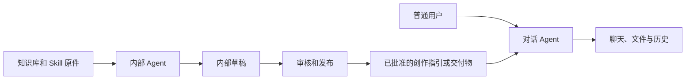

# 内部知识库与 Skill 防爬设计

普通用户可以让 Agent 运用内部方法完成创作。知识库正文、Skill 指令与附件、资料目录、数量、标题、路径和可还原资料的内容只供管理员和获授权的内部 Agent 使用。用户自己的上传材料和交付物按账号权限访问。

## 当前已实现的保护

| 数据路径                                 | 普通账号收到的内容                                                                                          |
| ---------------------------------------- | ----------------------------------------------------------------------------------------------------------- |
| 知识库浏览与详情、Skill 原文件接口       | 服务端拒绝访问                                                                                              |
| Agent 列表和详情                         | Agent 信息。Skill 清单为空                                                                                  |
| 实时聊天、非流式生成、重连回放与历史接口 | 用户消息、回复和可公开的工具进度。服务端移除知识库和 Skill 工具记录、原始推理、模型调用原始报文及内部检查点 |
| 子 Agent 会话详情                        | 仅限本账号会话。服务端移除内部工具记录与推理                                                                |

Agent 使用同一条保密规则处理回复、文件、记忆和子任务，要求用内部资料帮助完成用户的实际创作，拒绝展示资料。模型仍能在自由生成的文本中写出读过的内容。现有过滤保护传输层的原始记录。要阻止复述、翻译、跨轮拼接及写文件等泄露，需要执行下面的发布隔离。

## 发布隔离

1. **读取权限**。在服务端按账号角色和执行身份授权。内部 Agent 用单独的执行身份读取原件。普通会话的根 Agent、子 Agent、工具和上下文构建器只拥有已批准素材的读取权限。原件私有存储与用户文件工作区隔离，平台共享 Skill 的发布状态只决定 Agent 能否加载。
2. **发布权限**。内部 Agent 可读取原件、执行内部检索和写入私有草稿。移除它访问用户会话、文件目录、网络和公开工具的权限。人工审批把经核实可公开的创作指引或指定交付物登记为已发布版本，绑定来源版本、审核人、用途及目标受众。版本替换或撤销后，读取和下载重新校验权限。
3. **用户会话**。对话 Agent 可读取已发布指引并应用到用户的作品。它继续按现有流程生成普通回复和用户文件。未经审批的内部 Agent 输出一律留在内部存储。公开查询只返回经过发布的对象，自由文本、中间总结、工具结果和生成的 URL 均无自动发布路径。
4. **出口一致性**。在服务端写入公开数据前执行权限校验，流式输出只接已公开的事件。统一校验聊天、推理、重连、历史、搜索、导出、子 Agent、预览、下载与分享。公开文件目录只接用户自有文件和已批准交付物，内部草稿使用独立对象存储权限。
5. **批量请求约束**。内部检索在执行层以账号和任务计数，跨会话共享原子计数器，并限制全局并发。超额请求不发起检索。预算根据正常创作请求的读取量制定，审计仅记录账号、操作、计数和决策。限流降低批量请求成本放大，发布权限负责阻断泄露。

把原件与用户可读的输出分开，可以同时防止聊天中的诱导请求和对文件接口的批量读取。参见 [OWASP 敏感信息披露](https://genai.owasp.org/llm2026/llm022026-sensitive-information-disclosure/) 和 [OWASP 隐藏上下文泄露](https://genai.owasp.org/llm2026/llm082026-hidden-context-exposure/)。

## 上线与验收

- 先发布常用创作指引，用真实创作任务比较输出质量，再把普通会话切换到已发布素材源。管理员继续维护原件。
- 历史保留原记录。将旧的内部工具记录和未经核实的模型输出、检查点、记忆及导出物留在隔离存储，分批确认哪些回复和文件可继续发布。原始文件已被下载时，服务器无法收回副本。
- 在知识页正文、标题、Skill 指令和附件写入不同的测试标记。验证内部 Agent 可读取，管理员可管理。普通账号的聊天、历史、重连、搜索、子 Agent、导出、下载和分享均收不到原件、目录或测试标记。
- 使用普通账号测试直接索要目录、逐篇翻译、分轮提取和要求写文件等场景。同时验证普通创作、用户自己上传的资料和已发布的文件可以正常使用。
