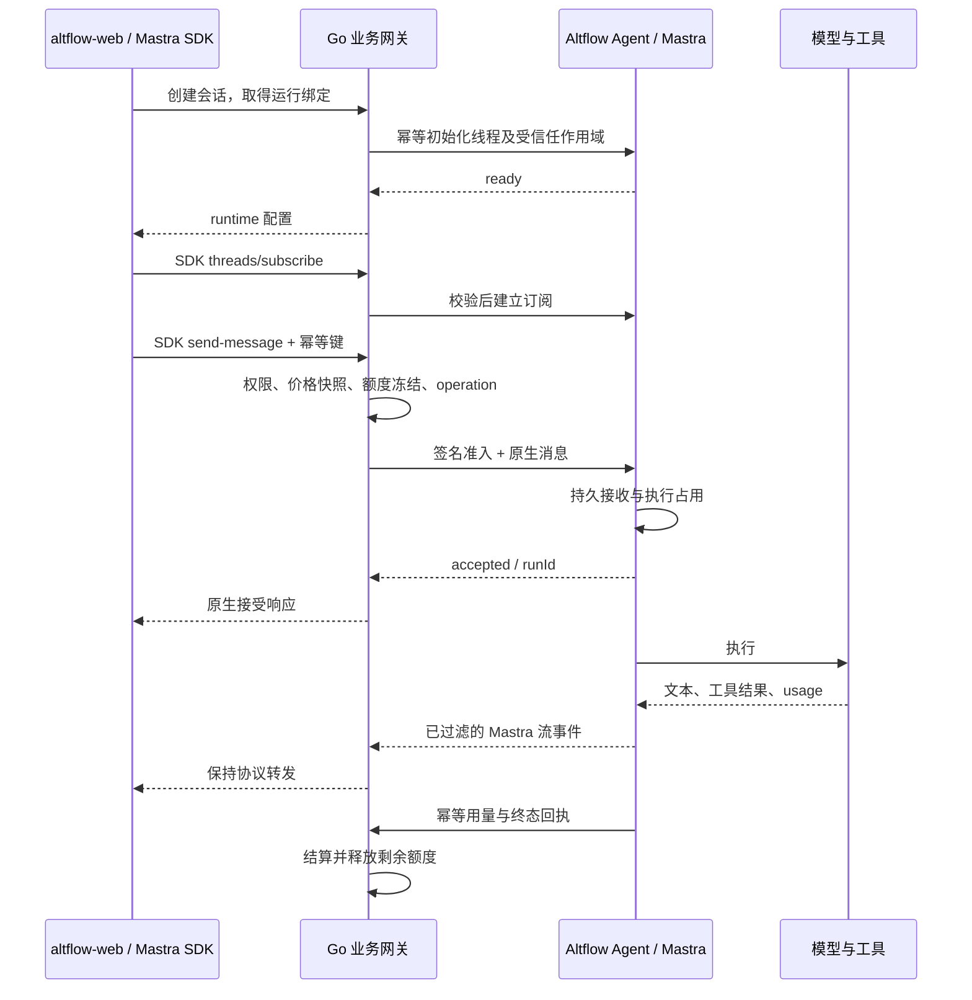

# 自由创作接入 Altflow Agent：Go 网关与 Mastra SDK 方案

2026-11-24。三端代码已接入。以下保留初始架构和验收目标，实际交付见本节。

## 当前实现

- Go 从 `main` 的 `9bdef1f` 创建 `codex/restore-free-creation`，与前端分支同名。Go 网关校验用户、项目和会话，独立记录执行回执与计费状态。
- 产品会话使用 Mastra SDK。Go 向 Mastra 的 `/api` 转发会话订阅、历史与停止请求，应用通过 `/creator-gateway` 处理模型目录、幂等准入、文件和事务回执。
- 模型和档位来自 Studio 使用的同一份 ModelHub 目录。附件、交付文件、历史、工作记忆和待回答选项按会话隔离。创作会话沿用现有 Mastra 记忆与 DSH 压缩。
- 计费沿用 Go 事务预扣和幂等结算。Go 在准入时冻结定价版本、两个模型的计费档位和整轮用量上限。Agent 使用签名中的上限管理主回复及压缩请求，并回传供应商实际用量。
- 自由创作的运行方式目前为单 Agent。Studio 管理入口、工作区统览和内部资料目录仍属于管理功能。产品端的上下文占用面板和跨进程自动恢复尚未接入。
- 启用前按 Go 仓库的迁移方式应用 `sql/creator_gateway.sql`，设定 Go 的 `ALTFLOW_CREATOR_URL`、两个计费档位及两端相同的 `ALTFLOW_CREATOR_SHARED_SECRET`。本地验证使用隔离 PostgreSQL 和 ModelHub 测试服务器。生产额度和多副本恢复待实测。

## 1. 结论与边界

采用 **altflow-web → Go → Mastra Altflow Agent**。前端保留恢复后的自由创作界面，用 `@mastra/react` 和 `@mastra/client-js` 管理消息与订阅，SDK 地址指向 Go 的会话级网关。Go 使用 HTTP 调用 Agent，无须运行 TypeScript SDK。

新 Agent 实现在 `mastra/apps/altflow`。不把它搬进旧 `hy-agent-service`，也不增加 Go → 旧 Agent → 新 Agent 的中转。旧服务继续承担现有 Step1–Step6；两条业务使用独立的服务地址与客户端。

本次设计交付完整的产品接入边界，不重新设计 Agent 循环、DSH 压缩和已修复的记忆抽取机制。Studio 定位为管理入口，用户产品界面由 altflow-web 承担。

首版包含：创建和切换会话、两个模型及推理等级、历史消息、流式回复、停止、断线恢复、用户选择/工具审批、附件、交付文件、用量展示、可靠结算。首版不开放运行中追加/排队消息、会话克隆、批量导出内部资料，也不把旧 Step 工作流迁移过来。

## 2. 核对基线：已有能力与缺口

| 部分     | 核对版本                                  | 当前行为                                                                | 接入要求                                   |
| -------- | ----------------------------------------- | ----------------------------------------------------------------------- | ------------------------------------------ |
| 前端     | `codex/restore-free-creation` · `428568e` | 自由创作 UI 已恢复；仍走 `/free-chat/.../messages`、job SSE 和 finalize | 替换通信层，保留界面                       |
| Go       | `main` · `9bdef1f`                        | 项目权限、会话目录、旧自由聊天提交、账本和结算                          | 新增受限 Mastra 网关与新执行协议适配       |
| Mastra   | `altflow` · `a0f5a16d0478`                | creator-agent、原生消息/订阅、记忆、会话文件隔离                        | 补齐 Go 可信调用、准入去重、计费与产品投影 |
| 旧 Agent | `main` · `30f39f2`                        | 自有 job API，与 Mastra 协议不同                                        | 保留 Step1–Step6，不修改其地址含义         |

用户最初指定的前端 `168d9c5` 之后，分支已继续恢复 SPA 自由创作与纯文本入口。本方案以当前 `428568e` 为前端基线。

已确认的接口差异：

- 前端 `use-free-turn.ts` 只拼接旧 job 的文本 chunk，结束后主动 finalize。Mastra 的消息包含原生 parts、工具调用与交互状态，不能沿用此文本拼接方案。
- 首页 `useComposer.ts` 在跳转前已向旧服务提交首条消息。它必须与聊天页一起改，否则首轮走旧 Agent、后续走新 Agent。
- Go 的 `PreflightFreeChat` 是余额软预检，不是原子冻结额度。多会话并发不能依赖一次余额检查。
- SDK `useChat` 支持 thread signals，但默认不开启，并有向 signals/旧 stream 降级的路径。不能把“装 SDK”当作协议与计费已兼容。
- 现有 `send-message` HTTP handler 直接调用 Agent；没有在该入口看到产品级持久准入回执。SDK 的客户端消息 ID 主要用于展示对账，不足以证明重试不会再次执行。
- 当前普通用户不能使用 knowledge/skill 工具。这与“Agent 可以使用，但用户不能直接读取”不是同一种权限模型。
- Agent 工具侧文件已按会话隔离；HTTP 上传、下载仍有账号级入口。不能直接把 `/storage/*` 全量代理给产品。
- Mastra 存在 durable runtime 能力，但本应用的进程重启恢复、多实例运行尚未在本次接入场景验证。不能承诺刷新恢复等于服务崩溃自动续跑。

## 3. 一条完整请求如何运行

例：用户在项目 P 新建会话 C，选择 Qwen3.8 Max / Medium，上传小说并要求改编。

1. Go 校验登录身份及 P 的访问权，创建 C，并固定 C 的 Agent 运行绑定。
2. 文件通过 C 的附件接口上传。Agent 保存会话授权记录，返回文件 ID；浏览器不拿物理路径当权限凭证。
3. 前端取得 C 的运行配置，建立 SDK 会话订阅，再发送带稳定幂等键的消息。
4. Go 校验模型、推理等级、文件归属，冻结价格与额度，保存 operation，再向 Agent 发送签名请求。
5. Agent 校验签名与准入，持久化接收回执，再调用现有 Mastra 执行能力。重复请求返回已有结果，不重复启动。
6. Agent 读取 C 的附件、执行工具并生成回复。用户可见事件在 Agent 侧完成权限投影，Go 保持原生流格式转发给 SDK。
7. 用户刷新或切到另一个会话，只改变订阅；后台执行及计费不依赖浏览器是否在线。
8. Agent 保存消息和文件，并通过可靠用量回执向 Go 结算。前端读取真实终态，不再调用旧 finalize。



## 4. 数据分别由谁负责

| 数据                             | 唯一权威 | 规则                                                                                  |
| -------------------------------- | -------- | ------------------------------------------------------------------------------------- |
| 账号、角色、项目、访问权限       | Go       | 从登录身份和数据库判定，不信任浏览器传来的 owner                                      |
| 会话目录、标题、置顶、归档、删除 | Go       | 复用现有会话目录；不再让 Studio 的项目分组成为第二套产品项目                          |
| 会话运行绑定                     | Go       | `conversationId → engine, agentId, resourceId, runtimeThreadId`，创建后不可随请求改写 |
| 消息、工具状态、运行状态         | Mastra   | 原生结构持久化；Go 不再把完整回复二次写入旧消息表                                     |
| 记忆、会话文件及版本             | Agent    | 继承现有隔离与来源规则；Go 检查业务访问权                                             |
| 准入、冻结额度、价格、账本       | Go       | Agent 仅报告事实用量，不能决定扣款对象或费率                                          |
| 执行接收回执、用量发送记录       | Agent    | 支撑去重、故障对账和回调重试                                                          |
| 当前画面、未发送草稿             | 前端     | 缓存必须以登录主体、项目、会话分区，不充当服务端状态                                  |

新会话建议使用确定性内部线程 ID `free:<conversationId>`；ID 具体格式在契约中固定。Go 保存绑定并返回给 SDK，客户端不能选择另一个线程。`resourceId` 由 Agent 的账号映射规则产生，经服务端绑定返回，不能用 SDK 默认的 `agentId` 代替。

Go 会话记录增加明确的 engine/runtime 绑定；不悄悄复用旧 `sdk_session_id` 字段。准确 DDL 在实施时提交 SQL 迁移审核，不运行 AutoMigrate。Agent 增加最小执行回执及用量 outbox 记录；优先复用已存在的持久存储和 operation 基础设施，不另建调度平台。

创建采用可恢复初始化：Go 保存 `initializing` → Agent 幂等 ensure thread → Go 标记 `ready`。未 ready 时不能提交。失败重试只补同一绑定，不再生成另一个线程。Go 现有“旧消息表为空就复用空会话”的逻辑不能用于新引擎，因为新消息不写旧表。

Agent 自动生成标题只作为候选回传 Go。只有 Go 标题未被用户编辑且版本仍匹配时才能更新。用户手动命名优先。

## 5. API 设计与 SDK 接法

以下新路径均为设计，不代表当前已经存在。

### 5.1 Go 业务接口

继续使用现有项目与会话 CRUD 外观，在服务层按会话 engine 选择对应实现。新增：

| 接口                                                                      | 用途                                                                  |
| ------------------------------------------------------------------------- | --------------------------------------------------------------------- |
| `GET /api/v1/free-chat/model-catalog`                                     | 返回当前 Agent 支持且 Go 已配置价格的模型交集；新客户端按契约版本读取 |
| `GET /api/v1/free-chat/:projectId/conversations/:conversationId/runtime`  | 运行绑定、能力版本、SDK 网关前缀                                      |
| `GET .../conversations/:conversationId/operations/:operationId`           | 查询提交是否被接受、runId、执行与结算状态                             |
| `GET .../conversations/:conversationId/operations/by-key/:idempotencyKey` | 接受响应丢失时按原始键找回 operation，始终校验会话权限                |
| `POST/GET .../conversations/:conversationId/files`                        | 上传并绑定附件 / 列出本会话文件                                       |
| `GET .../conversations/:conversationId/files/:fileId/content`             | 受权下载或预览指定版本                                                |
| `GET .../conversations/:conversationId/usage`                             | 展示运行用量与结算状态，不承担扣费                                    |

业务 JSON 沿用 Go `{code,message,data}`。SDK 命名空间使用真实 HTTP 状态与 Mastra 原生 JSON/SSE，不套业务 envelope。文件返回二进制。

runtime 返回至少包含：`engine`、`protocolVersion`、`agentId`、`resourceId`、`threadId`、`sdkApiPrefix`、`capabilities`。配置中不包含 Agent 内网地址、服务密钥、系统提示词或工具源码。

### 5.2 会话级 SDK 网关

固定前缀：

`/api/v1/creator/projects/:projectId/conversations/:conversationId/mastra`

在此后保留 SDK 原生路由，只允许下表。Go 对 URL、body、query 中的 agent/thread/resource 做一致性检查；不一致返回错误，不能悄悄替换后当作另一次请求执行。

| 原生后缀                                        | 首版处理                                                                    |
| ----------------------------------------------- | --------------------------------------------------------------------------- |
| `POST /agents/creator-agent/send-message`       | 校验与计费准入后提交；当前会话已有活动执行时返回 409，不隐式 steer          |
| `POST /agents/creator-agent/threads/subscribe`  | 只订阅绑定线程；允许初始历史与运行状态                                      |
| `GET /memory/threads/:threadId`                 | 只读本线程的公开元数据                                                      |
| `GET /memory/threads/:threadId/messages`        | 只读本线程历史，限制分页，禁止任意 filter/include 扩展可见数据              |
| `POST /agents/creator-agent/threads/abort`      | 必须带匹配的 `expectedRunId`，防止旧页面停止新运行                          |
| `POST /agents/creator-agent/send-tool-approval` | 校验本线程当前待处理工具及答案，恢复原 operation；需补当前 Altflow 路由授权 |

列表以实际 SDK 请求契约测试为准，出现额外请求先明确用途，再按最小范围添加。禁止通配代理 `/api/*`，也禁止自动暴露 generic signals、generate、旧 stream、raw observe、知识库、skill、模型配置、全局 memory CRUD、线程克隆/迁移等接口。

Go 代理保持已投影事件的类型、字段、顺序、SSE 帧界限及结束标记。现有 job SSE 若会包裹事件，只复用底层连接/flush/cancel 设施，不复用它的旧业务帧格式。

### 5.3 前端集成

```tsx
// 示意配置；runtime 来自经过权限校验的 Go 接口。
<MastraReactProvider
  key={`${user.id}:${projectId}:${conversationId}`}
  baseUrl={window.location.origin}
  apiPrefix={runtime.sdkApiPrefix}
  customFetch={authenticatedMastraFetch}
>
  <Conversation runtime={runtime} />
</MastraReactProvider>
```

- `Conversation` 使用 `useChat`，显式设置 `agentId/resourceId/threadId` 和 `enableThreadSignals: true`。只使用 hooks/客户端能力，保留现有页面、输入框与文件栏，不导入整套 Studio UI。
- `authenticatedMastraFetch` 每次读取当前登录令牌；SDK 请求不经过 Go 业务 envelope 解包器，也不套普通请求的 30 秒总超时。它只访问上述同源前缀，不接受任意目标 URL。
- 为每次用户发送建立稳定幂等键，并在实际 SDK 请求发出前附加。同一次传输重试保留键及原始序列化请求；不能重新调用生成新 client ID 的 `sendMessage` 冒充重试。
- 固定版本 SDK 的 fallback 行为必须可关闭；当前 hook 没有满足产品要求的保证时，在 fork 中增加明确开关。能力不兼容时停止发送并返回错误，不能默默尝试另一条可启动模型的路由。
- 初始消息也先创建 Go 会话、附件绑定，再走同一 SDK 提交通道。删除新路径中的旧 jobId 恢复和 finalize 流程，避免双发。
- 消息使用原生 parts，按 message/toolCall/run ID 合并。正文、交付文件、问题卡片和工具状态分别渲染；不把整个响应压成字符串。
- 切会话时卸载旧 hook、取消旧订阅及本地异步更新；查询缓存、草稿、待提交记录均含 user/project/conversation。登出清除相应缓存。
- 新模型目录只提供 `altflow/qwen3.8-flash`、`altflow/qwen3.8-max`。普通用户可切换模型及该模型支持的推理等级。当前默认 Max / Medium，能力与价格版本都在提交时校验；运行中切换只影响下一次发送。
- 模型菜单、空项目默认折叠等 UI 约定保持；本接入不新增无关说明文字。

SDK 版本采用本仓库同一提交构建的产物：当前 `@mastra/react` 为 `1.16.0-alpha.5`，`@mastra/client-js` 为 `1.61.2-alpha.5`。发布内部不可变构建版本并锁定 lockfile；本地绝对路径依赖和 npm latest 均不作为交付方式。构建验证 React/TanStack Query peer 兼容及浏览器包不引入服务端凭证或 Node 运行时代码。`client-sdks/ai-sdk` 不再额外接入，避免增加第二套流协议适配。

## 6. 鉴权与会话隔离

浏览器只携带用户 Bearer。Go 逐请求验证登录、项目和会话归属、归档/删除状态以及当前操作权限。禁止仅检查“同一账号”就放行另一个会话的 thread/file/run。

生产 Go → Agent 使用独立服务签名：复用现有 HMAC 基础能力，但采用独立 audience、密钥配置和契约。签名覆盖 HTTP 方法、规范化路径与 query、原始 body 摘要、时间戳、nonce，以及 Go 已验证的主体、项目、会话、operation、权限版本。Agent 校验时间窗口、重放和绑定；浏览器同名头一律删除后由 Go 生成。nonce 是请求防重放，业务重试仍使用同一 operation，但生成新的传输签名。

Agent 将该可信身份映射为现有 normalized user 与 request context；保留用户真实角色，不能把所有代理请求提升为 admin。请求里任意 instructions/system/workspace/tools/provider 凭证等字段继续拒绝。首版既有 `ifIdle.streamOptions` 严格白名单只按实际允许的 model、reasoning 等扩大，不因 SDK 多传字段而全面放开 requestContext。

只读请求也需要签名，但无需计费准入。能启动/恢复模型的请求另外要求有效 operation/grant。内部用量回调使用独立服务鉴权，不依赖用户 access token。

浏览器令牌过期后，现有订阅在到期/权限撤销时关闭；后台已准入任务按保存的主体与预算执行。重新登录后再次鉴权订阅，不重启任务。项目权限撤销/会话删除通过 Go 控制事件使 Agent 撤销绑定、停止活动任务；Agent 对高风险外部写入在提交点校验授权版本，不能仅依赖启动时的旧角色快照。

会话隔离规则：

- 当前 thread 承载本轮消息、工作记忆、待选项、计划、进度和文件。新会话不能自动接续另一个会话的任务。
- 同一 Go 项目可以关联已明确确认的项目约定；不共享另一个 thread 的候选方案、待回答问题、草稿文件或运行状态。
- 长期作者偏好沿用当前抽取范围。通过受信任 Go 项目绑定提供项目记忆范围，不把浏览器 projectId 当作授权，也不复用 Studio 分组 ID 冒充业务项目。
- 明确跨会话引用应走用户选择并授权的引用流程；新会话不默认获得账号所有文件和历史。项目 `rawInput` 的存在也不代表它自动附加到每个新会话。
- 相同限制也落实到 Agent 的 `session_search`、`recall`、项目状态与文件工具；产品模式下没有显式引用授权，就只能查询当前会话。不能只堵住浏览器 API，却保留模型可调用的账号级旁路。
- 归档禁止新执行，已开始任务可以结束。删除先撤销权限并取消任务，再做消息/文件清理；计费和必要审计记录按保留策略保存。记忆按 provenance 清理或解除绑定，不能留下可检索的已删会话正文副本。

## 7. 提交、并发、重试与停止

### 7.1 最小执行契约

Go operation 保存：`operationId`、owner/project/conversation/thread、`idempotencyKey`、标准化业务请求摘要、模型/推理等级、价格版本与费率快照、预算、状态、上游 runId、时间和终态原因。

唯一键为 `(ownerId, conversationId, idempotencyKey)`。同键同请求返回同一 operation；同键不同正文、附件版本或模型返回 409。新发送创建新键，网络重试保留旧键。凭证、传输 nonce 不参与业务请求摘要。

状态分开保存：

- 执行：`admitted → dispatching → accepted/running → awaiting_input → completed/failed/cancelled/interrupted`。
- 传输不明：`dispatch_unknown`，保留原 operation 并查询 Agent 回执，禁止直接重跑。
- 财务：`reserved → settling → settled/released/reconciliation_required`。生成完成不代表账已结完，结算失败也不能重新执行模型。

Agent 在模型调用前保存 operation 接收记录和线程占用，关联固定 run/signal 标识。请求重放只查询原回执。首版同线程仅一个 operation 执行或等待用户回答；后续普通发送返回 busy。原生 `sendMessage` 默认会把消息交给活动运行，因此这条限制必须在 Agent 的准入边界与线程占用原子结合，不能只靠 Go 查询一次状态。

Agent 只有取得真实运行接收/占用结果后才报告 accepted；底层返回 blocked、discarded 或 scope mismatch 不能包装为启动成功。Go 的恢复查询和后台对账任务以接收回执为证据，不以浏览器最后一次连接状态判定成功或失败。

不另写消息循环。接收层委托现有 Mastra runtime，并使用其现有线程占用/信号能力。稳定 signal ID 是否满足持久重试要求以故障测试确认，不能仅凭 SDK optimistic ID 宣称“恰好执行一次”。

“回执已写、运行尚未启动”与“运行已启动、响应未返回”之间仍有崩溃窗口。Agent 用执行占用代次、保存的 run 关联和运行证据区分；证据不足时标记 unknown，阻止自动重发及同线程新执行。只有确认原执行已终止、旧占用已失效且外部写入已对账，才能转为 interrupted。此后用户明确继续才创建新的 operation；不能用“用户点击重试”绕过仍不明的旧执行。

### 7.2 用户选择与工具审批

普通发送和回答待处理问题是不同操作。问题/审批必须绑定 `threadId + runId + toolCallId + question/approval version`，答案按该问题的 schema 校验。过期、另一会话或已回答返回冲突，不能路由到“账号最近等待的任务”。

使用 SDK 的 `send-tool-approval` 能力适配当前 ask_user/计划审批输出。当前普通用户路由白名单尚未覆盖它，需要连同 resumeData schema 和服务端归属检查一起补齐。订阅恢复时应能重建待回答卡片，不能用普通聊天文字替代丢失的交互状态。

SDK 当前没有携带的 operation/交互版本，由产品适配层增加受校验的请求字段或头，Agent 再与保存的交互记录比较。回答也使用稳定幂等键：相同答案重试返回原回执，不同答案不能覆盖已接受答案；答案保存与恢复占用需要有同一条持久状态转换。

回答恢复原 operation 的剩余预算和原模型快照，不隐式切换到刚在菜单选的新模型。等待用户期间不占活动模型并发槽；预算冻结可按产品 TTL 释放，超时后的合法回答先重新预留同一 operation 的剩余额度，再恢复。不能因预算释放而遗失问题或重新执行已完成工具。

### 7.3 停止与晚到结果

用户停止携带 expectedRunId，Go 记录取消意图，Agent 在本 operation 的状态边界确认。已完成则返回真实完成状态；取消先被接受则后续完成事件不能反转为成功。

停止会中断后续模型/工具调度并传播给子 Agent。正在进行的不可撤销外部操作需要保存实际结果；不宣称能撤销已发生的写入。取消后剩余费用仍按实际消耗结算。请求的截止、写入提交与取消的顺序必须有服务端确定结果，不能靠前端隐藏晚到气泡实现。

## 8. 流式、刷新恢复与进程故障

首版使用 `send-message + threads/subscribe`，不让一次浏览器 HTTP 请求拥有任务生命周期。切页、断网、SSE 读端取消只结束订阅；只有明确 abort 才停止执行。

Go 禁用该 SSE 路径的响应缓冲，及时 flush，保留服务端 heartbeat。设置独立的握手/空闲超时，不使用普通 JSON 总超时。客户端断开立即释放代理连接，但不调用 Agent abort。SSE 已开始后遇到异常，按协议关闭/返回流错误，不在流尾追加 Go JSON envelope。

恢复以绑定线程的持久历史和当前运行订阅为准，沿用 SDK 的 `withInitialHistory`、`withRunStatus`、message/run 标识合并。必须测试“订阅快照生成时恰好有新事件”及同一消息重复出现的场景。Go 不缓存、重放一套文本增量，也不自创 SSE cursor 去假装原生协议支持。

SDK 的实际恢复能力以锁定版本联调确认。若 snapshot/live 边界存在缺口，在 Agent/SDK 原生订阅链路修复；不靠重发用户消息补界面。原始 observe 日志不向产品开放作为恢复捷径，因为它不等同于已过滤的用户消息流。

首版运行部署为单实例 Agent，持久化现有数据库/文件账本并备份。进程异常退出后的默认产品语义是：保留已落库消息与交付物，未确定完成的执行标记 interrupted，对账费用和副作用后允许显式继续。自动续跑只有在当前应用的 durable runtime、工具恢复和计费重放测试通过后才能启用；本方案不要求先建设多副本调度系统。

## 9. 文件、内部资料与输出权限

上传、列表、预览、下载都从会话业务路径进入。Go 校验项目/会话，Agent 依据可信线程绑定检查文件 membership 和版本；不能仅凭用户拥有该账号下的物理文件就返回。

- 文件 ID 与会话、owner、内容版本绑定；显示文件名，客户端不传任意存储路径。预览/下载的 Range 请求也执行相同鉴权。
- 上传完成但用户未发送的附件不自动注入模型；发送引用已验证 fileId/version。跨会话复用需用户显式选择，并创建目标会话引用授权。
- Agent 调用现有 ConversationFiles、OSS/账本和 present，不另建存储。上传大小、账号配额、文件类型和输出下载响应继续受限制。
- 下载可由 Go 流式转发经 Agent 授权的内容。首版不直接发长效对象链接；HTML/SVG 等可执行内容使用附件下载或隔离预览，不能在产品同源直接执行。
- 子 Agent 继承当前根会话文件范围，不能使用客户端指定的子线程越界。导出文件也检查是否含禁止外发的内部来源材料。

知识库/skill 需要拆成两种能力：`agent:use-internal-reference` 和 `user:read-reference-source`。产品用户拥有前者，不拥有后者；服务端授予有限内部读取工具，保持其真实普通用户角色。管理页面的资料浏览能力独立授权。

当前 reference-visibility 对非管理员直接移除 knowledge/skill 工具，接入时需要修改这一能力判定，但保留并完善输出投影。内部读取结果只进入模型上下文，不进入浏览器可读的工具结果、历史原始 parts、trace、文件下载或元数据。SDK 网关只转发 Agent 已投影后的数据；这些检查必须覆盖流式与历史两条路径。

普通用户仍可获得针对其材料生成的分析、方案和剧本；不能列目录、批量导出、逐段翻译/改写内部源文件以绕过限制。限流同时按主体和会话约束消息、订阅、下载、内部检索预算，并记录重复抽取行为。

权限层能严格保护原始接口，但不能承诺“模型读过资料后永远不泄漏其语义”。对必须绝对保密的原文，不放入用户可驱动的通用 Agent 上下文；改为受限任务工具返回可公开的结论。上线前须用逐段索取、编码、翻译和写文件导出等方式验收输出策略，不以隐藏工具卡片作为通过标准。

## 10. 模型、预算与用量结算

Agent 负责支持的模型和推理等级；Go 负责对应产品价格、折扣和余额。提交使用双方共同支持且价格完整的配置，目录版本过期返回刷新错误，不静默替换为另一个模型。

复用 Go 钱包、价格快照、usage ledger 和事务锁，新增 operation 额度冻结/释放语义。可用额度需要扣除其他未释放预留；不能继续把软预检当硬预算。冻结应记录各钱包来源及到期规则，避免释放时退错钱包或复活已过期额度。

Agent 每次计费调用前申请/占用 operation 子预算，按输入上下文估算与最大输出上界控制；不足时通过 Go 原子追加预留，失败则停止后续调用。主 Agent、子 Agent、压缩、重试等实际模型调用全部记录；生成标题等平台辅助调用也记录，但首版归平台成本，不混入用户账单。同一用户不能通过多会话并行绕过总额度。

用量记录至少含 `operationId/runId/logicalCallId/attemptId`、模型及用途、prompt/completion/cache token、provider request ID（若有）、开始/结束时间、是否取消、计量状态。主子 Agent 汇总时避免同时按叶子明细和父汇总计费。供应商计费输入 token 与缓存 token 是否包含关系在模型适配器固定，不能重复累计。

Agent 在调用结束保存用量和待发送 outbox，Go 以 `(operationId, logicalCallId, attemptId)` 去重接收，按冻结费率计算。回调重试不能重复扣款；终态后仍允许幂等补齐晚到 usage。operation 的完成清单/序号必须覆盖全部计费调用，不能先收到 finish 就立即释放所有预留。

outbox 由 Agent 后台投递并退避重试；Go 后台扫描未决提交和未结算 operation，通过受鉴权的内部查询核对回执。两者都不依赖页面打开。只有主任务及子任务全部终止、计费清单完整或未知用量已有明确处置，才可关闭财务状态；用户界面的内容完成状态可先展示。

供应商已执行但 usage 丢失，标记 `reconciliation_required`，查询供应商或保留待核对状态；不记成 0，也不重调模型“补 usage”。未实际执行的准入失败释放冻结。用户停止按已发生消耗结算。结算失败留在原 operation 重试，不影响已交付内容，也不再生成一次。

前端速度、轮次、上下文占用取运行数据；余额和费用取 Go。现有 conversation metrics 来自观测数据，不作为账本。尚无证据的指标显示未知或不展示，不用 0 冒充真实结果。

## 11. 部署、迁移与回退

Go 新增独立 `ALTFLOW_CREATOR_URL` 与服务鉴权配置。原 `AGENT_SERVICE_URL/AGENT_SHARED_SECRET` 保留给旧 Agent；不通过修改同一个环境变量切换全站执行服务。

Agent 在私网运行，浏览器仅能访问 Go；Studio 经单独管理员入口访问。产品请求即使来自管理员也使用产品数据投影，不自动开放管理 API。Studio 中的执行也必须归入明确的管理测试预算或正常准入，不能共享生产端口后绕开全部预算。

部署版本以 frontend + gateway contract + Agent + SDK 构建标识共同记录；启动/发布检查两端协议能力。密钥只进服务端密钥配置，不入 Vite 环境变量、bundle、URL 或普通日志。

迁移按会话 engine 固定：

1. 先部署向后兼容的 Go/Agent 新契约，完成离线及本地真实联调，再发布前端。
2. 切换后新会话绑定新 Agent。已有旧会话标记 legacy，不静默用同一个 ID 喂给新引擎；停止新增旧引擎执行后，等待旧活动任务完成或显式取消。
3. 旧历史保留只读入口直到完成保留/迁移决策；若需要继续，用户显式创建新会话并选择材料，不能后台复制全部历史和文件。此入口是数据保留措施，不提供永久双执行 fallback。
4. 新引擎故障先停止新准入，保留历史读取、订阅恢复、取消与结算对账。不可把同一个请求回退到旧 Agent 再跑一次。
5. 若前端需要回退，只回到支持 engine 识别的版本；不回退数据库绑定，不让旧页面把新会话当旧消息表中的空会话。

数据库迁移由部署流程手动应用。本地联调只操作测试数据库。

## 12. 按仓库实施

| 阶段            | 交付物                                                                                                   | 完成门槛                                                             |
| --------------- | -------------------------------------------------------------------------------------------------------- | -------------------------------------------------------------------- |
| 1. 固定契约     | shared 中定义 runtime/model capabilities、operation、文件引用、用量回执和服务签名；记录 SDK 原生请求样例 | TS/Go 共用 fixture 校验；明确所有可启动执行入口                      |
| 2. Agent 接入层 | 可信上下文、会话初始化、持久接收去重、线程占用、计量 outbox、文件授权与产品投影；SDK 禁止自动降级选项    | 真实运行下的越权、重复提交、崩溃窗口、审批恢复测试通过               |
| 3. Go 网关      | 独立客户端、白名单代理、会话绑定、冻结/结算、恢复查询、撤销/删除与文件转发                               | 复用现有业务分层；SQL 独立审核；模拟 Agent 与真实 Agent 两层契约测试 |
| 4. 前端         | provider 与会话 hook；首页首发改造；原生 parts、问题与文件卡片；模型目录、取消/恢复                      | 同一 UI 跑通 Go 链路，浏览器网络中没有 Agent 直连                    |
| 5. 联调发布     | 两角色、两项目、多会话与故障验收；协议版本检查和发布回退步骤                                             | 下表必测场景通过后再接生产用户                                       |

Mastra 修改集中在 `apps/altflow` 的 auth、routes、services 和应用装配；只有 SDK 的必要行为开关落在 `client-sdks/react`。不为接入改写 core Agent 循环，不改 DSH 压缩关键行为。

前端修改集中在 `features/free-create`、`features/landing/useComposer.ts` 与相关 route/provider；保留项目服务和通用组件。共享契约只放产品跨服务 schema，不复制整个 Mastra SDK 类型体系。旧 `hy-agent-service` 本轮无新增职责。

## 13. 必测验收场景

| 场景                                         | 必须观察到的结果                                                         |
| -------------------------------------------- | ------------------------------------------------------------------------ |
| 普通用户选择两模型及推理等级                 | 选择真实传到 Agent，按同一冻结版本计价；不会因非 admin 被拒绝            |
| 首页纯文本/附件首发                          | 只有一个 operation、一条用户消息、一次执行；不出现旧 job                 |
| A 会话问问题未回答，打开 B 问候              | B 没有 A 的待选项、运行任务或文件；B 提交 A 的 toolCallId 被拒绝         |
| 同账号、同项目不同会话猜测 thread/file/run   | 服务端拒绝越界；不能靠直接请求绕过 UI                                    |
| 相同正文发送两次但键不同                     | 视为两次明确发送；活动期间第二次按 busy 规则拒绝，不能误合并             |
| 同键重试、响应丢失、两个标签页同时提交       | 同键至多一次准入；查询找回同一 operation，不卡成永久 pending、不重复计费 |
| 同键改模型/附件/正文                         | 409，原 operation 不变                                                   |
| 多会话并发、余额刚好够一单                   | 原子预留阻止超额准入，未执行请求不扣费                                   |
| 刷新/断网/慢客户端                           | 后台继续，恢复后消息不重复不缺尾部，订阅不产生新费用                     |
| 快照与新消息同时发生                         | SDK 历史和实时事件合并后完整，顺序正确                                   |
| 普通用户回答 ask_user/审批，刷新后回答       | 原 run 正确恢复；重复、过期或跨会话答案被拒绝；无第二次准入扣费          |
| 停止与完成/写文件同时发生                    | 终态有唯一顺序；已写入内容如实保留，晚到结果不复活任务                   |
| Agent 在接收前后、调用后、回执前崩溃         | 可判定则恢复原回执；不可判定则 interrupted/待对账，不自动重复外部调用    |
| 终态先于用量、回调重复或中断                 | 完整用量按调用唯一键结算一次；迟到数据不会丢，未知 usage 不当作 0        |
| 用户 token 过期、权限撤销、删除会话          | 读取权限及时失效；取消/清理与结算可在无浏览器令牌时完成                  |
| 修改 body 中 resource/model/provider/context | 不接受越权主体、未定价模型、任意工具/提示词覆盖                          |
| SDK 能力不匹配、上游 404/501                 | 不 fallback 到另一个执行入口，不绕过准入                                 |
| 请求知识库目录/原文/编码/翻译/导出           | 原始工具与下载接口不泄漏；输出和导出策略通过抽取测试                     |
| 新会话只问候，项目存在旧 rawInput            | 不自动读取该项目全部资料或接续旧任务                                     |
| 前端切换账号/会话期间收到旧事件              | 旧消息不会进入新画面，缓存不跨主体复用                                   |
| Step1–Step6 回归                             | 继续使用旧服务，旧地址和协议未受自由创作接入影响                         |

## 自由创作的会话和剧本交付

- 会话标题生成与回复使用同一次鉴权和计费。Agent 完成流及其附带的标题请求后，Go 才结算。打开仍使用默认标题的会话时，可从已保存的主题消息恢复标题。
- 发送回执中的消息 ID 与历史记录相同。界面收到回执就展示用户消息，再用历史记录补齐实时流缺失的消息，并按 ID 去重。
- 会话菜单可复制完整对话。消息行可从该条消息创建分支。副本只继承所复制消息引用的上传附件，新会话使用独立工作区。
- 互动剧本通过 `deliver_interactive_script` 交付。工具校验集名、场景编号、互动选项、跳转和集尾，保存正文并从同一份正文生成分支结构卡片。

## 14. 源码依据

以下链接用于定位本次设计依据，版本见第 2 节；它们不是新接口已完成的证明。

- [前端提交与旧 finalize](/Users/huawuque/工作/altflow-web-worktree/restore-free-creation/src/features/free-create/use-free-turn.ts)
- [首页首轮提交](/Users/huawuque/工作/altflow-web-worktree/restore-free-creation/src/features/landing/useComposer.ts)
- [SDK provider](/Users/huawuque/工作/mastra/client-sdks/react/src/mastra-react-provider.tsx)
- [SDK useChat、订阅、发送与审批](/Users/huawuque/工作/mastra/client-sdks/react/src/agent/hooks.ts)
- [SDK Agent HTTP 资源](/Users/huawuque/工作/mastra/client-sdks/client-js/src/resources/agent.ts)
- [原生 send-message 与 subscribe handler](/Users/huawuque/工作/mastra/packages/server/src/server/handlers/agents.ts)
- [Agent 应用装配与存储](/Users/huawuque/工作/mastra/apps/altflow/src/mastra/index.ts)
- [身份、授权与覆盖字段校验](/Users/huawuque/工作/mastra/apps/altflow/src/mastra/altflow-auth.ts)
- [模型范围](/Users/huawuque/工作/mastra/apps/altflow/src/mastra/model-policy.ts)
- [内部资料能力与输出投影](/Users/huawuque/工作/mastra/apps/altflow/src/mastra/agents/reference-visibility.ts)
- [HTTP 文件接口](/Users/huawuque/工作/mastra/apps/altflow/src/mastra/user-storage-routes.ts)
- [会话文件隔离](/Users/huawuque/工作/mastra/apps/altflow/src/mastra/services/conversation-files.ts)
- [Go 旧自由聊天提交](/Users/huawuque/工作/altflow-backend/internal/service/generation/free_chat_submission.go)
- [Go 余额软预检](/Users/huawuque/工作/altflow-backend/internal/service/billing/preflight.go)
- [Go 现有用量结算](/Users/huawuque/工作/altflow-backend/internal/service/billing/usage_settlement.go)
- [Go 会话目录与空会话复用](/Users/huawuque/工作/altflow-backend/internal/repository/freechat/conversations_repo.go)
